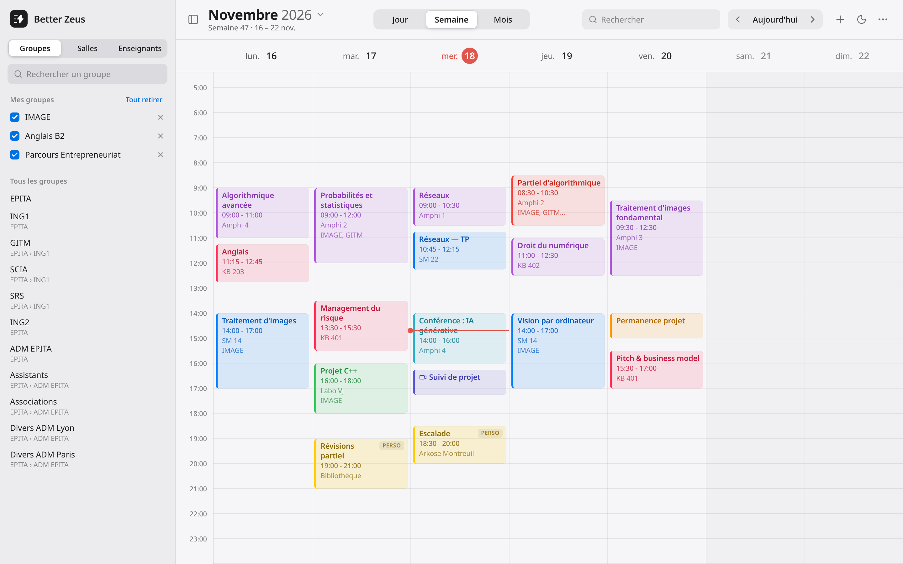
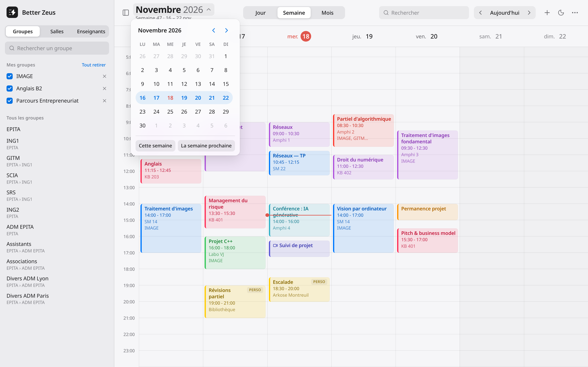
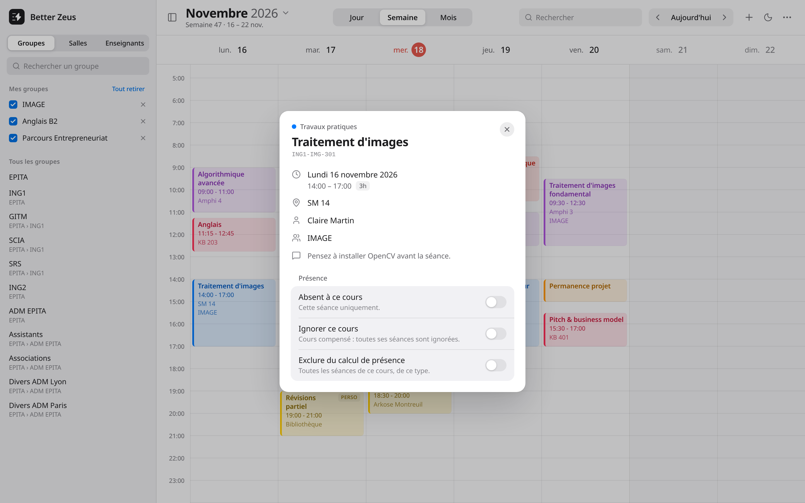
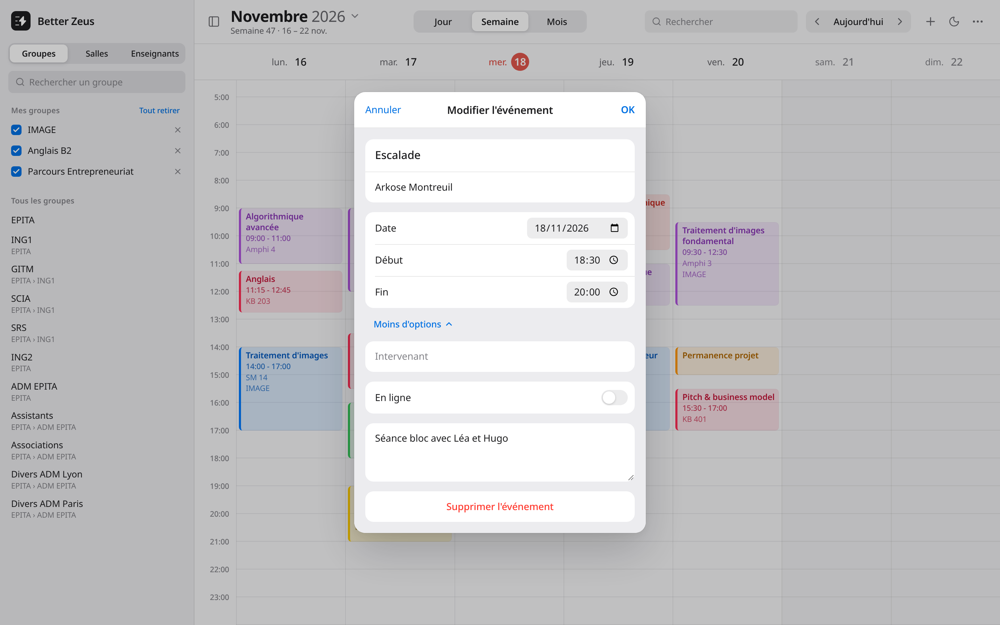
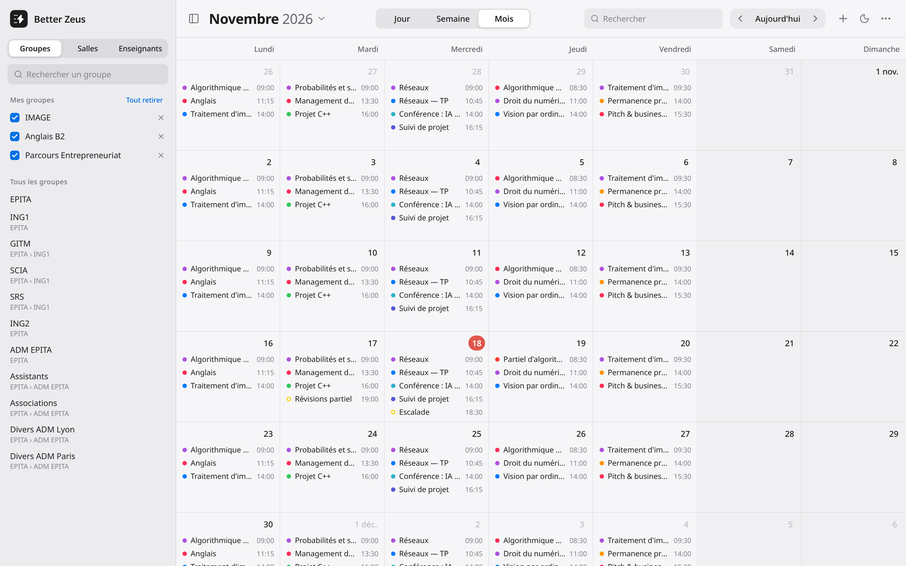
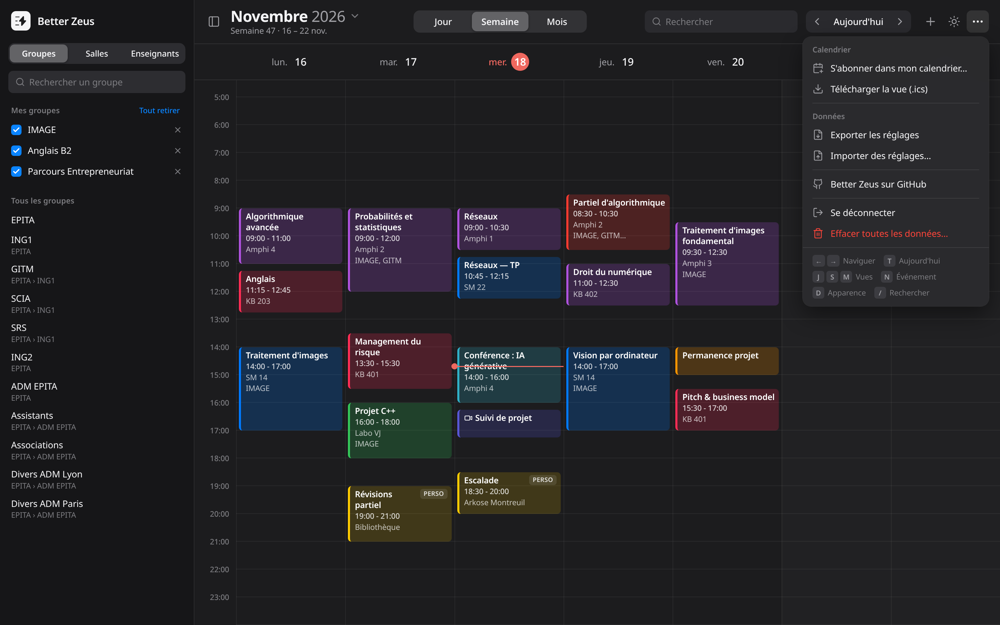
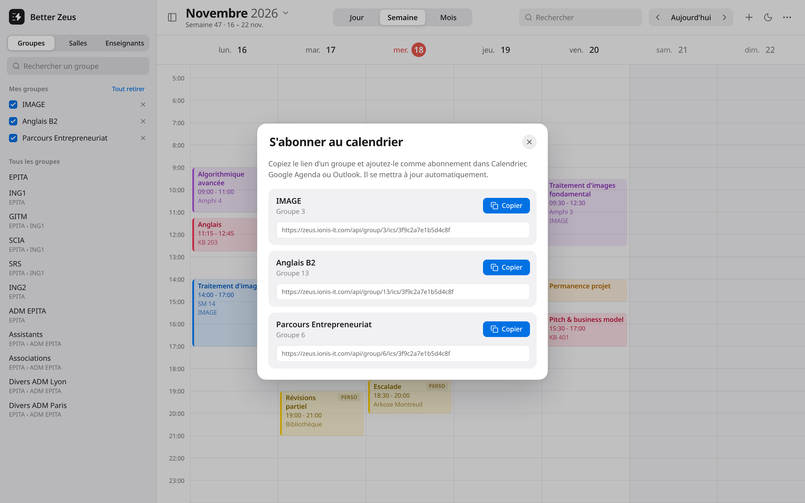
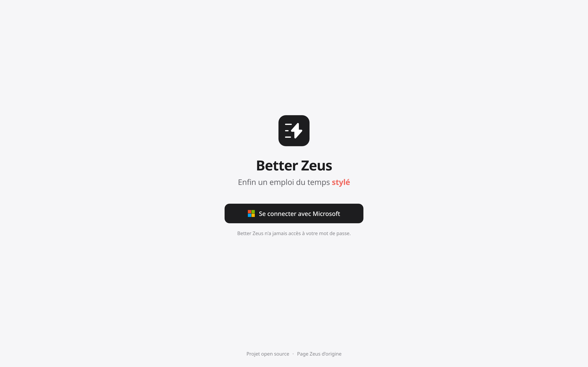

<div align="center">
  

# Better Zeus

Zeus sucks. So i made a better version, with a cool UI.

  <p>
    <a href="#installation">Installation</a> •
    <a href="#features">Features</a> •
    <a href="#screenshots--demos">Demos</a> •
    <a href="#contributing">Contribute</a>
  </p>
</div>

---



## Installation (Chrome based browsers & Firefox)

Check the release page and follow the instructions :

## [**GitHub Releases**](https://github.com/axthauvin/better-zeus/releases/)

## Features

- **Day, week and month views** with a clean, Apple-inspired design — today and the current time are always easy to spot.
- **Light and dark mode**, switchable in one click (or with the `D` key).
- **Colored events by course type** (lecture, practical, exam, conference…) for quick reading.
- **Groups, rooms or teachers**: pick what you want to see from the sidebar, your selection is remembered.
- **Personal events**: add your own events to the calendar and edit them with a simple click.
- **Calendar subscription (iCal)**: subscribe to your groups in Apple Calendar, Google Calendar or Outlook, or download the current view as `.ics`.
- **Keyboard shortcuts**: `←` `→` to navigate, `T` for today, `J` `S` `M` to switch view, `N` for a new event, `/` to search.
- **Responsive** layout that works on small screens too.

---

## Screenshots & Demos


**Jump to any date** — click the title to open the date picker.



**Event details** — everything about a course at a glance.



**Personal events** — click one of your events to edit it.



**Month view**



**Dark mode** — and every option in a single menu.



**Subscribe in your calendar app**



**Sign in**



## Contributing

Pull requests and suggestions are welcome!
Feel free to open issues or submit feature ideas.

## Local Development

To use and build the extension locally:

```bash
pnpm install # please dont be a jerk and use pnpm
pnpm run build
```

This project uses [React](https://react.dev) to make it easier to develop and maintain. If you want to contribute, make sure to follow the code style and structure.

<div align="center">
<br/> <b> Enjoy Better Zeus!</b></div>
